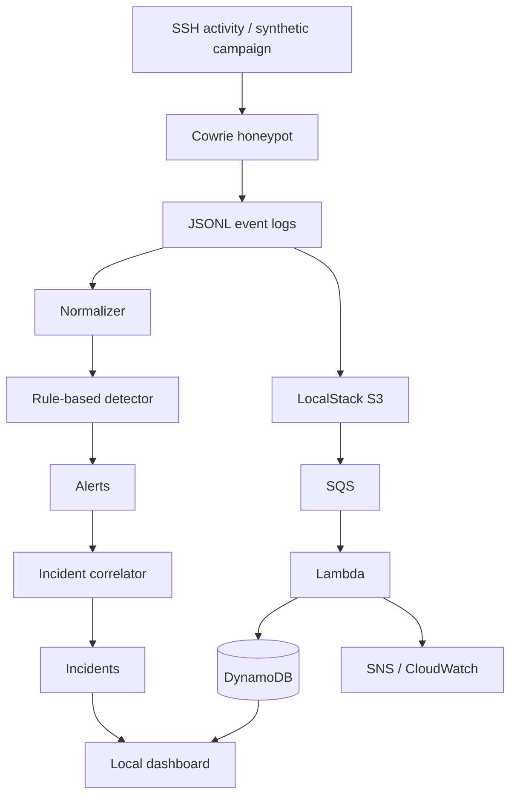

# CloudTrap

**A local-first SSH honeypot, rule-based threat detection and incident-correlation lab, with an AWS-style architecture simulated using LocalStack and Terraform.**

> **Zero-spend demo:** Terraform's AWS provider is pinned to `http://localhost:4566` (LocalStack), not AWS. The synthetic demo and unit tests do not contact AWS or consume AWS credits. Preserve this endpoint guardrail.

## At a glance
- **9** synthetic SSH events generated.
- **4** rule-based alerts (3 high, 1 medium).
- **2** correlated high-severity incidents.
- **29** unit tests currently passing.
- Cowrie, processor, dashboard and LocalStack ports bind to localhost by default.

## Architecture


## Documentation
- [Technical README](README.md): setup, architecture and operations.
- [Non-technical README](README_NON_TECHNICAL.md): plain-English explanation.
- [Architecture](docs/ARCHITECTURE.md): data flow, services and trust boundaries.
- [Demo & interview guide](docs/DEMO_AND_INTERVIEW_GUIDE.md): demo steps, talking points and interview questions.

## Quick start — synthetic demo
Requirements: Python 3.10+ and `make`.
```bash
make test
make demo
make dashboard
```
Open **http://127.0.0.1:8502**. Synthetic mode reads only generated files under `data/processed`; it does not call AWS or LocalStack.

## LocalStack + Terraform simulation
Requirements: Docker Desktop, Docker Compose, Terraform 1.6+ and Python 3.10+.
```bash
make stack-up
make infra-init
make infra-import-existing
make infra-plan
```
Review the plan. The AWS provider uses dummy credentials and service endpoints at `http://localhost:4566`. When the plan shows the intended LocalStack resources, run:
```bash
make infra-apply
```
This emulates S3, SQS, Lambda, DynamoDB, SNS, IAM and CloudWatch. It is not a real AWS deployment. The import step safely adopts resources already created by an earlier LocalStack bootstrap; on a fresh LocalStack instance it simply skips resources that do not exist. The synthetic dashboard runs on port 8502; Docker dashboard is on port 8501.

Remove simulated resources with `make infra-destroy`; stop containers with `docker compose down`.

## Local Cowrie session
Start the stack with `make stack-up`, then connect to the decoy service:
```bash
ssh -p 2222 root@127.0.0.1
```
Use only a disposable test password. Never enter personal credentials. Exit with `exit`. Raw logs are stored under `data/cowrie/var/log/cowrie/` and ignored by Git.

Process locally captured logs with `make pipeline`.

## Detection rules
| Rule | Current behavior |
|---|---|
| `authentication.brute_force` | Five or more failed SSH logins from one source inside five minutes |
| `authentication.failure_then_success` | Successful login after failed authentication attempts from the same source within the look-back window |
| `suspicious.remote_script_execution` | Detects command patterns piping remote content directly to a shell |
| `suspicious.persistence_attempt` | Detects command patterns associated with scheduled-task persistence |

These are explainable heuristics, not proof of compromise. They may require tuning to reduce false positives.

## Repository layout
```text
CloudTrap/
├── .github/workflows/ci.yml
├── data/                          # Runtime data (ignored by Git)
├── docs/                          # Architecture and interview diagrams
├── infra/localstack/              # LocalStack init hook
├── infra/terraform/               # LocalStack-pinned infrastructure
├── scripts/                       # Campaign generator, pipeline, Lambda packager
├── services/dashboard/            # Local metadata dashboard
├── services/lambda/               # LocalStack Lambda consumer
├── services/processor/            # Normalization, detection, correlation, tests
├── Makefile
├── README.md
└── README_NON_TECHNICAL.md
```

## Security notes
- Cowrie listens on `127.0.0.1:2222`; do not expose it publicly without a separate hardened deployment plan.
- LocalStack listens on `127.0.0.1:4566`; dashboards bind to localhost.
- Dashboard responses use allowlists and exclude passwords and raw command text.
- Runtime logs, generated JSON, Terraform state, build archives and secrets are excluded from Git.
- Synthetic IPs use documentation-only TEST-NET ranges.
- CI runs tests and Terraform validation only; it never deploys infrastructure.
- No live AWS credentials, resources, billing or credits are needed for the demo.

## Tests
```bash
make test
```
GitHub Actions runs Python compilation, unit tests, Lambda packaging and Terraform formatting/validation. It does not run `terraform apply`.

## Limitations and future work
Rule-based detection is a baseline, not ML or external threat intelligence. LocalStack is an emulator, not proof of production AWS behavior. SNS email delivery is not enabled in the zero-spend demo. Production deployment would require a dedicated account, explicit cost controls, IAM review, network isolation, retention policy, monitoring and security testing.

## License
No license has been selected. Add one before accepting external contributions or granting reuse rights.
