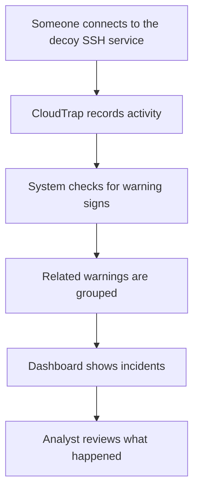

# CloudTrap — A Plain-English Guide

## What is CloudTrap?
CloudTrap is a demonstration security system that watches activity against a fake SSH login service. SSH is a common way administrators connect to computers remotely. Attackers may try passwords repeatedly or run commands after gaining access.

CloudTrap gives those attempts a safe place to be observed. It records what happened, looks for warning signs, groups related warnings together, and shows the results on a dashboard.

## Why build it?
Security teams can receive thousands of separate log messages. Reading each one manually is slow. CloudTrap demonstrates how raw activity can be turned into a smaller number of meaningful incidents for a person to investigate.

## How it works

1. **Observe:** Cowrie provides a fake SSH service and records activity.
2. **Understand:** CloudTrap converts records into a consistent format.
3. **Detect:** It looks for patterns such as repeated failed logins or suspicious commands.
4. **Group:** It combines related warnings into one incident.
5. **Review:** A dashboard displays the incidents and severity.

## What does the demo show?
The sample campaign creates nine artificial events. CloudTrap identifies four alerts and groups them into two incidents:
- One incident represents repeated failed logins followed by a successful login.
- One incident represents suspicious remote-script execution and an attempt to create scheduled persistence.

These are generated examples, not evidence of real attacks.

## Why LocalStack and Terraform?
AWS offers services for storing files, passing messages, running code, saving records and sending notifications. LocalStack imitates selected AWS services on the developer's computer. Terraform describes which simulated resources should exist. This lets the project practise a cloud-style design without deploying resources to a real AWS account or consuming AWS credits.

## What this project is — and is not
**It is:** a learning and portfolio project, a controlled SSH honeypot demonstration, a rule-based detection pipeline, and a local simulation of cloud architecture.

**It is not:** a commercial security product, a guarantee that every attack will be detected, proof a real computer was compromised, or a live AWS deployment in the zero-spend demo.

## Run the simple demonstration
Requires Python 3 and `make`:
```bash
make test
make demo
make dashboard
```
Open `http://127.0.0.1:8502`.

## Interview explanation
"I built CloudTrap to demonstrate how security monitoring can turn noisy login and command activity into actionable incidents. It uses a decoy SSH service to collect events, simple rules to identify suspicious patterns, and correlation to group related alerts. I added a dashboard so the results are easy to review. I also modelled an AWS-style pipeline locally with LocalStack and Terraform, which lets me demonstrate the architecture without spending money on cloud resources."
