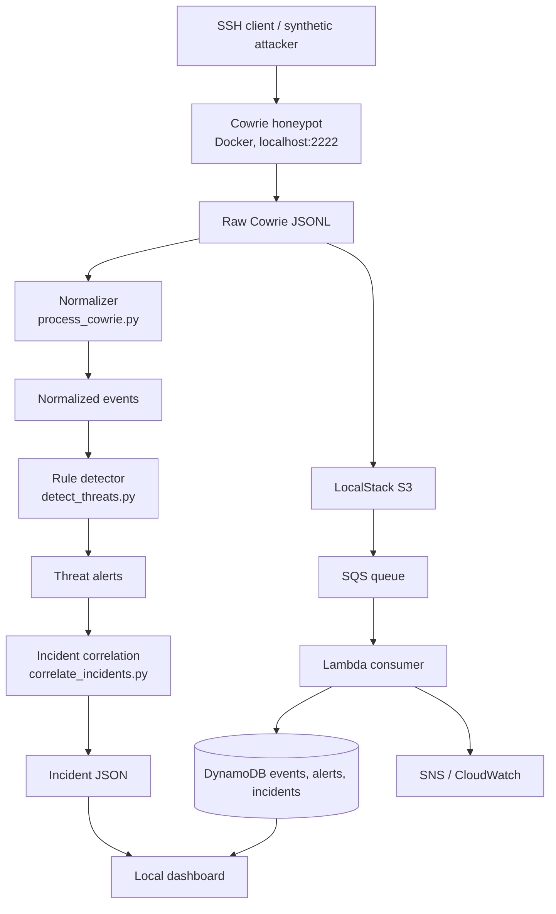
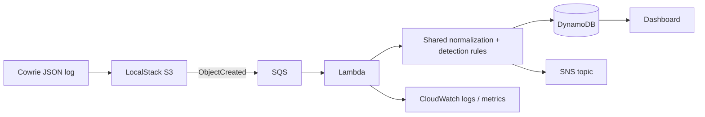

# CloudTrap Architecture

## Purpose
CloudTrap is a defensive SSH honeypot and event-analysis pipeline. Cowrie records activity in an isolated fake SSH environment. CloudTrap normalizes those records, applies transparent detection rules, groups related alerts into incidents, and presents safe metadata in a dashboard.

## End-to-end flow

## LocalStack event-driven simulation

LocalStack emulates selected AWS APIs on the developer's Mac. The endpoints are `localhost:4566`; no AWS account is contacted.

## Component responsibilities
| Component | Responsibility | Why |
|---|---|---|
| Cowrie | Emulates SSH and records sessions | Observe activity without exposing a real shell |
| Normalizer | Converts Cowrie records to a stable schema | Keep detection independent of raw log format |
| Detector | Applies explicit authentication and command rules | Explainable, testable threat identification |
| Correlator | Groups alerts by source and time window | Investigate incidents instead of isolated alerts |
| LocalStack | Emulates selected AWS APIs | Test cloud patterns without cloud spend |
| Terraform | Declares simulated infrastructure | Rebuild resources consistently |
| Dashboard | Displays safe metadata | Make findings understandable |

## Current detection rules
- `authentication.brute_force`: five or more failed SSH logins from one source in the configured five-minute window.
- `authentication.failure_then_success`: successful login follows failed authentication attempts from the same source within the look-back window.
- `suspicious.remote_script_execution`: command patterns indicate remote content piped directly into a shell.
- `suspicious.persistence_attempt`: command patterns indicate scheduled-task persistence activity.

These are heuristics, not proof of compromise. A production detector needs tuning, richer context and analyst review.

## Trust boundaries
- Cowrie binds to `127.0.0.1:2222`; it is not publicly exposed by default.
- LocalStack binds to `127.0.0.1:4566`.
- Dashboard binds to localhost (`8501` in Docker, `8502` for direct synthetic demo).
- Dashboard responses use field allowlists and omit passwords and raw command text.
- `infra/terraform/provider.tf` pins provider endpoints to LocalStack and uses dummy credentials. Preserve this guardrail in the zero-spend workflow.
- Synthetic source IPs use TEST-NET documentation ranges, not real attacker addresses.

## Demonstration modes
1. Fast synthetic demo: `make demo`, then `make dashboard`. No containers or cloud emulator required.
2. Infrastructure simulation: `make stack-up`, `make infra-init`, `make infra-plan`, review, then `make infra-apply`. All emulated endpoints remain on localhost. Terraform must be installed.
