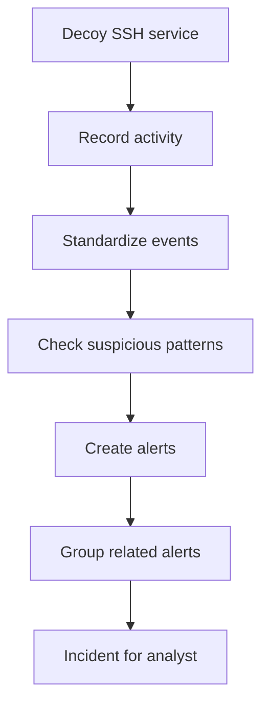

# CloudTrap Demo and Interview Guide

## 60-second explanation — non-technical
"CloudTrap is a small security monitoring system. It creates a safe fake SSH service that records suspicious login attempts and commands. The software checks those records for warning signs, groups related warnings into incidents, and displays the results on a dashboard. I can replay simulated attacks to demonstrate the process. I use LocalStack and Terraform to practise the cloud architecture locally, so the demo does not need a live AWS deployment."

## 60-second explanation — technical
"Cowrie emits JSONL session events. A normalization layer maps Cowrie records into a stable schema, then a deterministic rule engine detects brute-force authentication, failure-followed-by-success, remote script execution and persistence indicators. The correlation engine groups alerts by source and time window and assigns deterministic incident identifiers. For cloud-pattern testing, LocalStack emulates S3, SQS, Lambda, DynamoDB, SNS and CloudWatch. Terraform declares the resources, and the Lambda consumer reuses the same processor modules. The dashboard exposes allowlisted metadata and suppresses credentials and raw command strings."

## Demo steps
Fast synthetic demo (no AWS, no LocalStack):
```bash
make test
make demo
make dashboard
```
Open `http://127.0.0.1:8502`.
Expected result: 9 synthetic events, 4 alerts (3 high, 1 medium), 2 high-severity incidents, 0 malformed lines.

Local infrastructure simulation:
```bash
make stack-up
make infra-init
make infra-import-existing
make infra-plan
```
Review the plan; the AWS provider must point to `http://localhost:4566`. Then run `make infra-apply` to create resources inside LocalStack only.

## Explain the incidents
1. Authentication: one simulated source makes five failed SSH login attempts and then succeeds. Two alerts are grouped into one incident.
2. Command activity: another source runs a remote-script pattern and a scheduled-task persistence pattern. Two alerts are grouped into a second incident.

`203.0.113.10`, `198.51.100.24` and `192.0.2.45` are TEST-NET documentation addresses, not real attackers.

## Likely interview questions
**Why a honeypot?** A controlled decoy gives defenders a place to observe suspicious activity without intentionally exposing a real application or account.

**Why Cowrie?** It emulates SSH/Telnet services and records session behavior as structured events.

**Why normalize?** A stable schema makes detection, correlation, testing and future integrations easier.

**How does detection work?** Explicit, deterministic rules count failed logins in a time window and match suspicious command patterns. It is not currently an ML classifier.

**What is correlation?** Related alerts from the same source and time window become one incident, reducing fragmented warnings.

**Why LocalStack?** It emulates selected AWS APIs locally so cloud-style workflows can be tested without creating AWS resources.

**Why Terraform?** Infrastructure as code makes the local environment repeatable and allows a plan to be reviewed before applying.

**Limitations?** Heuristics can produce false positives or miss new behavior. Synthetic events are not threat intelligence. LocalStack is an emulator, not proof of production AWS behavior.

**How would you productionize it?** Use a dedicated account, isolated network, least-privilege IAM, encryption, retention policies, dead-letter queues, monitored alert delivery, budgets and security testing. Do not expose a honeypot to a trusted network.

## Simple explanation diagram

